## Hi, I'm Justin 👋

I build the systems other software runs on: control planes, job queues and test infrastructure.
Each project here is a small version of a real platform, built the way real ones are: crash
recovery, auth and roles, CI, and tests that prove the tricky parts actually work.

- 🎓 Computer Science student at **Inter American University of Puerto Rico**, Aguadilla Campus · Class of 2027
- 🎯 Looking for **software/programming, data and cloud internships**
- 💬 Ask me about reconciler loops, job queues without a broker, or hunting flaky tests

---

## 🚀 Featured projects

### ☁️ [cloud-resource-manager](https://github.com/Justin-Chevere/cloud-resource-manager) &nbsp;

**A declarative control plane for containers, modeled on Kubernetes.** The API only records the
*desired* state; a reconciler loop makes reality match it.

- **Self-healing by design:** the reconciler is level-triggered and idempotent, so crashed
  containers come back and restarting the control plane loses nothing
- **Secure by default:** JWT auth with viewer, operator and admin roles, login rate limiting, and
  an audit log written in the same transaction as every change
- **Observable:** CPU and memory sampled every 15 s and charted in a React + TypeScript dashboard
- **Tested where it matters:** a test walks every endpoint in the OpenAPI schema and fails if any
  private one answers an anonymous request

Python · FastAPI · SQLAlchemy · React · TypeScript · GitHub Actions

### 🧪 [test-platform](https://github.com/Justin-Chevere/test-platform) &nbsp;

**A self-hosted test runner, like a small CI service.** Queue a run, and a worker checks out that
exact commit, runs its tests in a fresh virtualenv, and records every test's result.

- **A job queue with no broker:** workers claim runs with one atomic `UPDATE`, so no run is ever
  claimed twice. A race test caught the classic select-then-update bug 5 times out of 5
- **Survives crashes:** heartbeats, leases and fencing tokens. When a worker was killed mid-run,
  another took over 4.8 s later and finished it: 92 tests passed on attempt 2
- **Finds flaky tests:** reruns failures automatically, flags tests that passed and failed on the
  same commit, and quarantines known flakes so they stop breaking builds
- **Tracks trends:** median and p95 duration and failure rate per test, against the previous window

Python · FastAPI · SQLAlchemy · Alembic · JUnit XML · GitHub Actions on Linux and Windows

---

## 🛠️ Tech I work with

<table>
  <tr>
    <td><b>Languages</b></td>
    <td>
      
      
      
    </td>
  </tr>
  <tr>
    <td><b>Backend</b></td>
    <td>
      
      
      
      
    </td>
  </tr>
  <tr>
    <td><b>Frontend</b></td>
    <td>
      
      
    </td>
  </tr>
  <tr>
    <td><b>Testing&nbsp;&amp;&nbsp;CI</b></td>
    <td>
      
      
      
      
    </td>
  </tr>
</table>

## 🔭 Up next

- A **Docker runtime** for cloud-resource-manager, so the reconciler starts and stops real containers
- A **Docker runner** and **GitHub webhooks** for test-platform: isolated runs, and pass or fail
  reported on every commit

## 🤝 Let's connect

